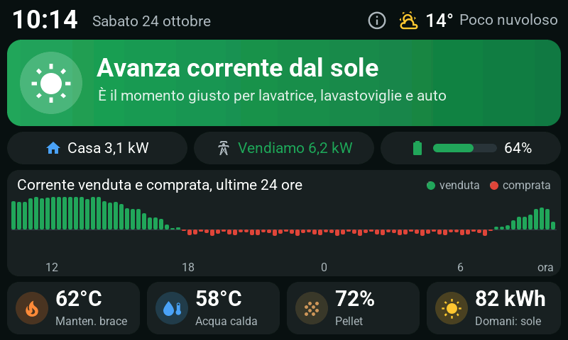
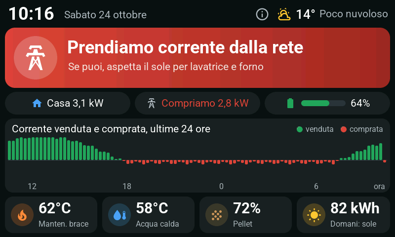
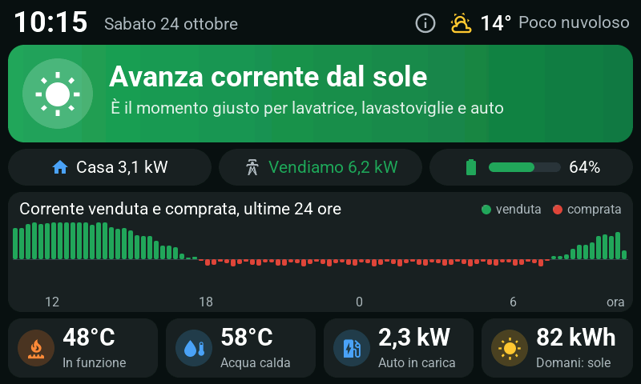
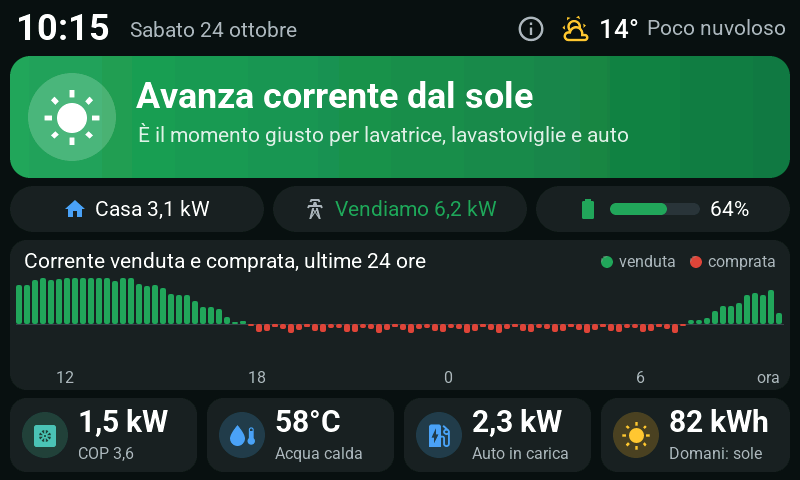
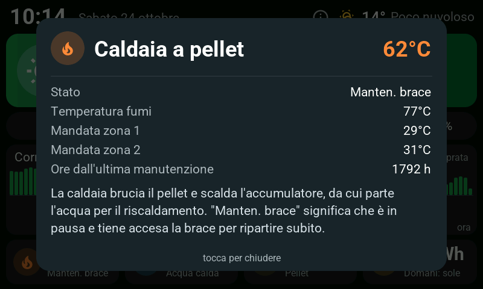
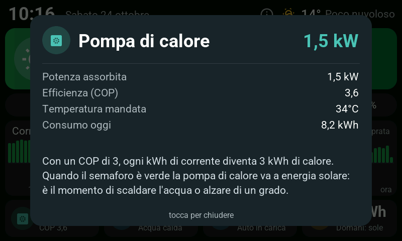
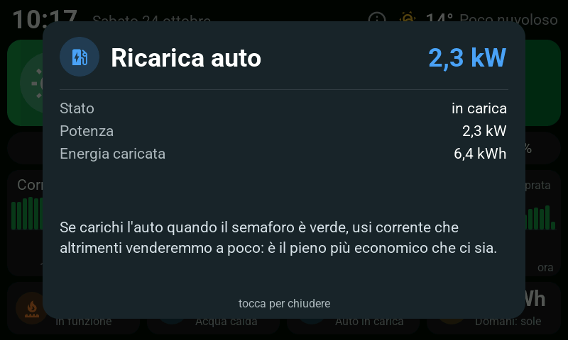
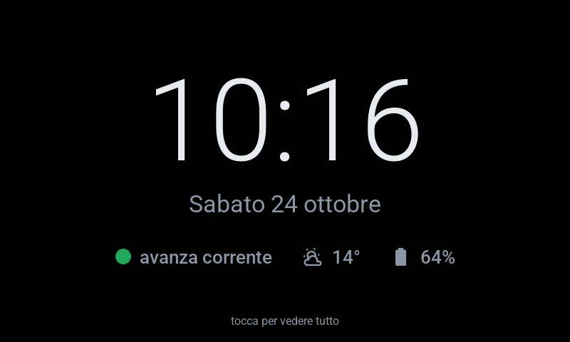

# Energy Display for ESPHome

A wall display that teaches the household when to use solar energy: a traffic light on grid power, a scrolling 24-hour grid chart, weather and four swappable tiles — **read-only** from Home Assistant, UI in Italian.

## Screenshots

Taken from the desktop simulator with demo data.

| | |
|---|---|
| <br>Pellet profile, green semaforo: a lot of export | <br>Red semaforo: importing from the grid |
| <br>Gas boiler profile | <br>Heat pump profile |
| <br>Pellet boiler popup | <br>Heat pump popup |
| <br>Gas boiler + car charging popup | <br>Screensaver, shown after 60 s idle |

## Hardware

Waveshare ESP32-S3-Touch-LCD-7: 800x480 RGB panel driven with `rpi_dpi_rgb`, 8 MB flash, 8 MB octal PSRAM, GT911 capacitive touch, CH422G I/O expander for backlight and touch reset. Backlight is **on/off only** (no PWM), which is all the night mode needs.

## What it shows

- **Semaforo** — green above `${green_export_w}` (2500 W) exported, yellow in between, red above `${red_import_w}` (800 W) imported. Both are calibration knobs in `ui.yaml`; grid values are averaged over 30 s so the colour does not flicker.
- **Pills** — `Rete` (grid, or "Rete a zero"), `Casa` (house load) and battery percentage.
- **Last 24 hours chart** — scrolling window, newest on the right ("ora"): one bar per 15 minutes, green upward for exported energy, red downward for imported, scaled to `chart_full_scale_w`; hour labels move with the bars. Saved to flash once per completed slot (under 1 KB, ~96 writes a day) and restored after a reboot.
- **Info button** — the (i) next to the weather opens a short "how to read it" popup.
- **Weather** — current conditions and temperature only (a forecast would need a service call, which is off-limits here).
- **Big-load reminder** — shown 10:30–12:30 when today's forecast beats `reminder_forecast_kwh`, with the text in `reminder_text`.
- **Screensaver** — after 60 s idle a big clock replaces the dashboard. At night (22:00–06:30) the backlight turns off after 10 minutes untouched; any touch wakes it and returns to the main page.

## Tiles = modules

The four bottom slots are filled by modules from `firmware/tiles/`. Each one declares the vars it needs in its header:

| Module | Shows | Required vars |
|---|---|---|
| `boiler_pellet.yaml` | Pellet boiler: temp, state, flue gas, two heating circuits, hours to maintenance; popup | `slot, temp, state, flue, flow1, flow2, maint, circuit1_name, circuit2_name` |
| `dhw.yaml` | Domestic hot water tank: temp, pump state, heat source label | `slot, temp, pump, source` |
| `pellet_hopper.yaml` | Pellet store level with ash-box warning and usage counters | `slot, level, ash_hours, used, total` |
| `pv.yaml` | Solar production today plus grid exchange (uses `fc_today_kwh` / `fc_tomorrow_kwh` from the device file) | `slot, pv_today, exported_today, imported_today` |
| `boiler_gas.yaml` | Gas boiler: flow temp, flame, modulation, gas today, pressure | `slot, flow_temp, flame, modulation, gas_today, pressure` |
| `heatpump.yaml` | Heat pump: power, COP, flow temp, energy today | `slot, power, cop, flow_temp, energy_today` |
| `ev_charger.yaml` | Car charging: power and energy | `slot, power, energy` |

Pick one module per slot in `packages` — the default in `energy-display.yaml` is the pellet profile:

```yaml
packages:
  ui: !include ui.yaml
  tile1: !include
    file: tiles/boiler_pellet.yaml
    vars:
      slot: 1
      temp: sensor.boiler_temperature
      state: sensor.boiler_state
      flue: sensor.boiler_flue_gas_temperature
      flow1: sensor.heating_circuit_1_flow_temperature
      flow2: sensor.heating_circuit_2_flow_temperature
      maint: sensor.boiler_hours_since_maintenance
      circuit1_name: "Mandata zona 1"
      circuit2_name: "Mandata zona 2"
  tile2: !include
    file: tiles/dhw.yaml
    vars: { slot: 2, temp: sensor.dhw_temperature, pump: sensor.dhw_pump, source: "caldaia a pellet" }
  tile3: !include
    file: tiles/pellet_hopper.yaml
    vars:
      slot: 3
      level: sensor.pellet_hopper_level
      ash_hours: sensor.boiler_hours_until_ash_box
      used: sensor.pellet_usage_counter
      total: sensor.pellet_total_consumption
  tile4: !include
    file: tiles/pv.yaml
    vars:
      slot: 4
      pv_today: sensor.pv_energy_today
      exported_today: sensor.grid_exported_energy_today
      imported_today: sensor.grid_imported_energy_today
```

Three complete example profiles live in `sim_*.yaml`:

| Profile | tile1 | tile2 | tile3 | tile4 |
|---|---|---|---|---|
| Pellet | `boiler_pellet` | `dhw` (pellet boiler) | `pellet_hopper` | `pv` |
| Gas | `boiler_gas` | `dhw` (gas boiler) | `ev_charger` | `pv` |
| Heat pump | `heatpump` | `dhw` (heat pump) | `ev_charger` | `pv` |

Honest status: `boiler_pellet`, `dhw`, `pellet_hopper` and `pv` are tested on real hardware with a Froeling pellet boiler; `boiler_gas`, `heatpump` and `ev_charger` exist only in the simulator so far — PRs welcome. Each module can be used at most once.

## Read-only by design

Every state arrives through ESPHome's native API (`platform: homeassistant`). There is no Home Assistant token on the device and no `homeassistant.action` anywhere in the config: the display can only read. When adopting the device in Home Assistant, leave **"Allow the device to perform Home Assistant actions"** OFF.

## Setup

```bash
cp firmware/secrets.yaml.example firmware/secrets.yaml   # fill in WiFi, API key, OTA password
# map your entities in the substitutions of energy-display.yaml and the tile vars
esphome run firmware/energy-display.yaml
```

## Simulator

Runs the whole UI in an SDL window with fake data — no hardware needed. Requires SDL2 and a recent clang (macOS 13+ or Linux).

```bash
esphome run firmware/sim_pellet.yaml     # or sim_gas.yaml / sim_heatpump.yaml
```

Environment variables (from `sim_base.yaml`): `SIM_RED=1` red scenario, `SIM_SAVER=1` open the screensaver, `SIM_POPUP=1..4` open a tile popup, `SIM_SHOT=/path.bmp` save a screenshot after ~20 s and exit.

On macOS, if the C++ headers are not found:

```bash
export SDKROOT=$(xcrun --show-sdk-path) CPLUS_INCLUDE_PATH=$SDKROOT/usr/include/c++/v1
```

## Support

If this taught someone at home to run the washing machine when the sun is out, you can [buy me a coffee](https://paypal.me/merighidaniel). Modules for other boilers, heat pumps or chargers are just as welcome.

## Credits and license

MIT — see `LICENSE`. The Material Design Icons webfont (`firmware/fonts/`) is by Pictogrammers, Apache 2.0. Roboto is fetched at build time from Google Fonts (`gfonts://`).
